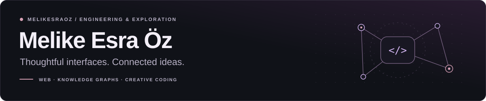

<picture>
  <source media="(prefers-color-scheme: dark)" srcset="./assets/profile-header-dark.svg">
  <source media="(prefers-color-scheme: light)" srcset="./assets/profile-header-light.svg">
  
</picture>

  <strong>Computer Engineer · Frontend &amp; Full-Stack Development</strong> 
  Akdeniz University graduate · Türkiye

  <a href="https://www.linkedin.com/in/melike-esra-öz">LinkedIn</a>
  &nbsp; · &nbsp;
  <a href="mailto:melikesraozz@gmail.com">Email</a>

I build web applications, connect interfaces to APIs, and explore knowledge graphs and retrieval-augmented generation (RAG). I enjoy turning complex ideas into clear, usable software.

## Selected work

### [MusicKG-QA ↗](https://github.com/melikesraoz/kg-multihop-qa-turkish-music)

Multi-hop question answering over a Turkish music knowledge graph, with graph-guided retrieval, an evaluation workflow, and a presentation dashboard.

`Python` `Neo4j` `RAG`

### [Evently ↗](https://github.com/melikesraoz/evently-app)

A React and TypeScript interface for an event platform, with event, user, and reporting screens.

`React` `TypeScript` `Material UI`

## Tools I work with

| Area | Technologies |
| :--- | :--- |
| **Frontend** | React · Angular · TypeScript · JavaScript |
| **Backend & data** | Python · FastAPI · Node.js · Java · PostgreSQL · Neo4j |
| **Development** | Git · Docker |

## Currently exploring

- Graph-based AI and RAG workflows.
- Testing with Vitest and building small game prototypes.

<!-- Profile artwork lives in assets/ and supports both light and dark themes. -->
